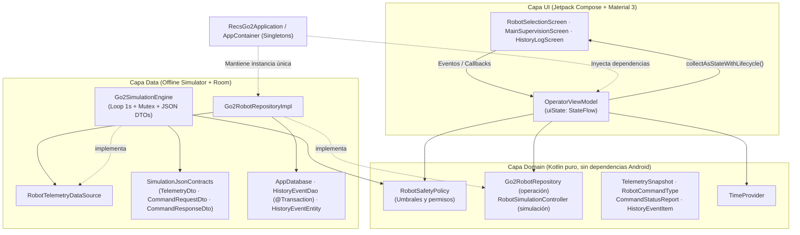

# Guardaparques RECS — Consola HMI/HRI para Unitree Go2 EDU

Aplicación Android nativa (Kotlin + Jetpack Compose + Material 3 + Room + Coroutines/StateFlow) desarrollada para el **Trabajo Práctico Grupal de Desarrollo de Aplicaciones I (UADE)**.

Simula de forma 100% offline la operación supervisada e interacción humano-robot (HRI) de un cuadrúpedo **Unitree Go2 EDU (`GO2-RECS-01`)** asistiendo al cuerpo de guardaparques de la **Reserva Ecológica Costanera Sur (RECS)** en patrullajes preventivos contra focos ígneos.

---

## 1. Caso de uso, entorno y plataforma

- **Servicio y lugar real:** Patrullaje preventivo de detección temprana de incendios e incidentes en el circuito **Sector Sur — Laguna de los Coipos (3.8 km)** de la RECS, Ciudad de Buenos Aires, dividido en 6 waypoints (`WP0` Base Acceso Brasil → `WP1` Sendero de los Sauces → `WP2` Mirador Norte → `WP3` Cortafuegos Este → `WP4` Camino Costero Río de la Plata → `WP5` Sendero Retorno Sur).
- **Actores:**
  - **Guardaparque operador (HMI):** Supervisa telemetría en tiempo real, reconoce alertas (ACK) y emite órdenes discretas desde la app Android.
  - **Visitantes / ciclistas del sendero (HRI):** Reciben señalización luminosa (baliza) y acústica (altavoz / sirena) emitida por el robot en terreno.
- **Justificación Unitree Go2 EDU:** Locomoción cuadrúpeda apta para senderos de tierra, pastizales y obstáculos bajos (ramas/troncos) donde un vehículo con ruedas pierde tracción.
  - *Capacidades base del Go2:* desplazamiento cuadrúpedo, LiDAR 4D integrado para evasión/freno ante obstáculos, estado de batería/postura.
  - *Equipamiento adicional modelado para el servicio:* módulo térmico IR, sensor de humo/CO, enlace celular 4G LTE con telemetría y unidad de señalización HRI (baliza RGB + altavoz direccional).

---

## 2. Arquitectura (MVVM + Clean Architecture + UDF)

El proyecto sigue **Clean Architecture** en 3 capas (`domain`, `data`, `ui`) más un contenedor manual de dependencias (`di`) atado al ciclo de vida de `Application` (`RecsGo2Application`), con flujo unidireccional de datos y `StateFlow` expuestos siempre en modo **solo lectura** hacia la UI.



### Reglas arquitectónicas aplicadas
1. **Aislamiento de la UI:** Ningún `@Composable` referencia `Go2SimulationEngine`, `HistoryEventDao`, `AppDatabase` ni al repositorio. La UI únicamente observa `StateFlow<HmiUiState>` mediante `collectAsStateWithLifecycle()` y dispara lambdas hacia `OperatorViewModel`.
2. **StateFlow de solo lectura:** Todos los `MutableStateFlow` y `MutableSharedFlow` son `private`; se exponen exclusivamente mediante `.asStateFlow()`, `.asSharedFlow()` o `.stateIn(..., SharingStarted.WhileSubscribed(5000L), ...)`.
3. **Reglas de negocio compartidas (`RobotSafetyPolicy`):** Los umbrales de seguridad (`20%` batería mínima, `25%` alerta preventiva, `70.0 °C` bloqueo térmico, `200 ppm` humo crítico, `5 s` antigüedad de datos) y las precondiciones de los 7 comandos viven en `domain/policy/RobotSafetyPolicy.kt`, usados tanto por el ViewModel como por el simulador.
4. **Separación entre robot y simulador:** `Go2RobotRepository` define únicamente la supervisión y operación real del robot, mientras `RobotSimulationController` separa el disparo de escenarios (1–5) y fallas forzadas para la demostración.
5. **Instancias únicas a nivel `Application` (`RecsGo2Application` + `AppContainer`):** El motor simulado y la base Room viven a nivel `Application` (con `Closeable` y scopes controlados), evitando fugas de corrutinas o duplicación de registros al recrear `MainActivity`.
6. **Transacciones atómicas en Room:** `HistoryEventDao` es una `abstract class` con métodos `@Transaction` para operaciones de varios pasos (`seedIfEmpty` e `insertAndPrune` con límite de 200 eventos) y esquema JSON exportado (`app/schemas/.../1.json`).

---

## 3. Guía de archivos del proyecto

| Paquete / Archivo | Responsabilidad |
|---|---|
| `RecsGo2Application.kt` | Inicializa el `AppContainer` único de la app. |
| `di/AppContainer.kt` | Contenedor manual que provee `TimeProvider`, `AppDatabase`, `Go2SimulationEngine` y `Go2RobotRepositoryImpl`. |
| `MainActivity.kt` | Activity principal con Compose, `NavigationBar` M3 (`Unidades`, `Supervisión HMI`, `Historial Local`) y tema estático `dynamicColor = false`. |
| `domain/model/TelemetryModels.kt` | Modelos de telemetría (8 variables base + 3 de servicio ígneo + HRI) y catálogo de waypoints `WP0..WP5`. |
| `domain/model/CommandModels.kt` | Los 7 comandos discretos, estados (`IDLE`, `PENDING`, `CONFIRMED`, `REJECTED`, `NO_RESPONSE`), los 5 escenarios e ítems de historial. |
| `domain/policy/RobotSafetyPolicy.kt` | Reglas de seguridad, umbrales, `CommandPermissions` y `validateCommand(...)`. |
| `domain/repository/Go2RobotRepository.kt` | Contrato puro de operación del robot e historial. |
| `domain/repository/RobotSimulationController.kt` | Contrato separado para controles de demostración/simulación. |
| `domain/util/TimeProvider.kt` | Interfaz de reloj para poder testear tiempos sin depender de la hora del sistema. |
| `data/simulator/SimulationJsonContracts.kt` | DTOs y serialización/deserialización `kotlinx.serialization` de telemetría y comandos. |
| `data/simulator/RobotTelemetryDataSource.kt` | Interfaz de data source y eventos de dominio (`MissionStarted`, `MissionCompleted`, `AlertTriggered`, `AlertAcknowledged`). |
| `data/simulator/Go2SimulationEngine.kt` | Motor autónomo offline (tick 1s, latencia 450 ms, timeout 3 s, protección térmica, pausas RTH y alertas orgánicas). |
| `data/local/room/AppDatabase.kt` | Base Room v1 (`recs_go2_hmi.db`) con `exportSchema = true`. |
| `data/local/room/HistoryEventDao.kt` | DAO con queries reactivos `Flow` y transacciones `@Transaction` (`seedIfEmpty`, `insertAndPrune`). |
| `data/local/room/HistoryEventEntity.kt` | Entidad SQLite y mapper `toDomain()`. |
| `data/repository/Go2RobotRepositoryImpl.kt` | Conecta `RobotTelemetryDataSource` con Room y registra comandos, misiones, alertas e interrupciones 4G. |
| `ui/viewmodel/OperatorViewModel.kt` | Combina los flujos en `StateFlow<HmiUiState>`, calcula `isDataStale`, pide confirmación en órdenes destructivas y gestiona modales. |
| `ui/screens/RobotSelectionScreen.kt` | Pantalla 1: tarjeta activa `GO2-RECS-01` (estado real de enlace/ubicación/batería) y unidad `GO2-RECS-02` deshabilitada M3. |
| `ui/screens/MainSupervisionScreen.kt` | Pantalla 2: panel HMI en 5 zonas + diálogos de confirmación y alerta crítica. |
| `ui/screens/HistoryLogScreen.kt` | Pantalla 3: filtros por categoría, `LazyColumn` y confirmación antes de vaciar Room. |
| `ui/components/TacticalMapCard.kt` | Mapa vectorial en `Canvas` con circuito, interpolación de posición, halo de fuego y modo congelado. |
| `ui/components/HmiComponents.kt` | Tarjetas de telemetría, barra HRI, banner de comandos y `ModalBottomSheet` del simulador. |
| `ui/theme/*` | Paleta fija *Tactical Outdoor Dark M3* (`dynamicColor = false`) y tipografía monoespaciada de telemetría. |

---

## 4. Contratos JSON propuestos (Simulación Offline)

> **Nota explícita (consigna TP):** Los esquemas JSON documentados a continuación conforman un **contrato propuesto a nivel aplicación** para desacoplar la simulación offline dentro de `SimulationJsonContracts.kt`. **No representan ni deben interpretarse como protocolo oficial de Unitree Robotics.**

### 4.1. Paquete de Telemetría (`TelemetryDto`)

Incluye conectividad, energía, estado operativo, misión/progreso, ubicación GPS, cinemática/postura, alertas activas, timestamp, las **3 variables de servicio** (`maxThermalTempC`, `smokePpm`, `fireWeatherRisk` + contexto meteorológico) y estado HRI:

```json
{
  "connectivityStatus": "ONLINE",
  "rssiDbm": -65,
  "batteryPercent": 82,
  "voltageV": 28.8,
  "operationalState": "ALERT_HOLD",
  "missionId": "MIS-#043",
  "currentWaypointIndex": 3,
  "currentWaypointName": "Cortafuegos Este - Zona Cortaderas",
  "missionProgressPercent": 50,
  "latitude": -34.6118,
  "longitude": -58.3512,
  "sectorName": "Sector Sur — Laguna de los Coipos (3.8 km)",
  "linearSpeedMps": 0.0,
  "headingDeg": 132,
  "posture": "ALERT_HOLD • Frenado automático a 5m del foco",
  "activeAlerts": [
    {
      "id": "ALT-FIRE-1795000000000",
      "severity": "CRITICAL",
      "category": "FIRE",
      "title": "¡ALERTA CRÍTICA! Foco Ígneo Detectado en WP3",
      "description": "Cámara IR: 114.5 °C | Humo: 390 ppm en WP3 Cortafuegos Este. Robot frenado a 5m (ALERT_HOLD).",
      "waypointIndex": 3,
      "isAcknowledged": false,
      "timestampEpochMs": 1795000000000
    }
  ],
  "lastUpdatedEpochMs": 1795000000000,
  "maxThermalTempC": 114.5,
  "smokePpm": 390,
  "fireWeatherRisk": "EXTREMO",
  "windSpeedKmh": 34,
  "windDirection": "SE",
  "humidityPercent": 18,
  "hriBeaconMode": "Baliza Roja + Sirena Evacuación",
  "hriSpeakerAnnouncement": "ALERTA INCENDIO: Visitantes evacuar Cortafuegos Este",
  "hriIsEmergencyAlarm": true
}
```

### 4.2. Solicitud de Comando Discreto (`CommandRequestDto`)

```json
{
  "command": "ACK_ALERT",
  "alertIdToAck": "ALT-FIRE-1795000000000",
  "sentEpochMs": 1795000005120
}
```

Valores válidos de `command`: `START_MISSION`, `PAUSE_MISSION`, `RESUME_MISSION`, `CANCEL_MISSION`, `RETURN_TO_SAFE`, `OPERATIONAL_STOP`, `ACK_ALERT`.

### 4.3. Respuesta del Robot (`CommandResponseDto`)

**Confirmada (`CONFIRMED`):**
```json
{
  "command": "START_MISSION",
  "status": "CONFIRMED",
  "message": "✅ CONFIRMADA: MIS-#043 iniciada por el Go2 (ACK)",
  "timestampEpochMs": 1795000000450
}
```

**Rechazada por regla de seguridad (`REJECTED`):**
```json
{
  "command": "RESUME_MISSION",
  "status": "REJECTED",
  "message": "RECHAZADA: Protección térmica activa (114.5 °C). Prohibido avanzar hacia el fuego; solicite Regreso a Punto Seguro",
  "timestampEpochMs": 1795000008450
}
```

**Sin respuesta por timeout de enlace 4G (`NO_RESPONSE`):**
```json
{
  "command": "PAUSE_MISSION",
  "status": "NO_RESPONSE",
  "message": "⚠️ SIN RESPUESTA: Timeout de red 4G agotado tras 3s",
  "timestampEpochMs": 1795000012000
}
```

---

## 5. Los 5 escenarios demostrables

Accesibles desde los chips `E1`–`E5` o desde el botón **Simulador (1–5)** en `MainSupervisionScreen`:

1. **E1 — Misión Normal:** Arranca en `WP0` (`IDLE`, 95% batería, 24.2 °C, 12 ppm). Al enviar `START_MISSION`, recorre `WP0 → WP5` hasta el 100%, regresa a `WP0` (`IDLE`) y registra inicio/fin en Room.
2. **E2 — Batería Baja (18%):** Posiciona la unidad en `WP2` en estado `PAUSED` con alerta `WARNING` (18%). Bloquea `Iniciar` y `Reanudar` patrulla, resalta **Regreso Seguro (RTH)** y permite evacuar hacia `WP0`.
3. **E3 — Desconexión 4G y Datos Antiguos:** Simula corte en cañadón `WP4` (`68%`, enlace cortado, timestamp congelado). Al superar 5 s muestra borde ámbar discontinuo y etiqueta **DATO ANTIGUO (CONGELADO)**; cualquier comando entra en `PENDING` y expira en `NO_RESPONSE` a los 3 s; al presionar **Restaurar Señal 4G** retoma telemetría en vivo.
4. **E4 — Incidente (Obstáculo LiDAR 4D en WP5):** Sauce caído de 35 cm bloquea el sendero; el robot frena en `ALERT_HOLD`. Exige `ACK_ALERT` antes de permitir `RESUME_MISSION` (desvío lateral) o `RETURN_TO_SAFE`.
5. **E5 — Escenario propio (Foco Ígneo en WP3):** Cámara IR detecta `114.5 °C`, humo `390 ppm` e índice `EXTREMO`. Frena a 5 m en `ALERT_HOLD` y activa sirena/baliza HRI de evacuación para visitantes. Bloquea `RESUME_MISSION` (`REJECTED`) incluso después de `ACK_ALERT`, dejando **RTH (`WP0`)** o **Detención Operativa** como acciones seguras.

---

## 6. Riesgos operativos y medidas de mitigación

| # | Riesgo identificado | Medida en interfaz / lógica / procedimiento |
|---|---|---|
| 1 | **Colisión o alarma en visitantes cercanos en senderos públicos (HRI)** | Barra de estado HRI permanente que refleja baliza luminosa y anuncio de altavoz (cortesía, precaución o evacuación). Ante obstáculos LiDAR o fuego, el robot pasa a `ALERT_HOLD` (`0.0 m/s`) antes de cualquier maniobra. |
| 2 | **Envío accidental de órdenes destructivas o críticas en campo** | Sin joystick continuo; solo 7 botones discretos con precondiciones estrictas (`RobotSafetyPolicy`). `CANCEL_MISSION`, `OPERATIONAL_STOP` y el borrado del historial Room exigen diálogo modal de confirmación explícita. |
| 3 | **Operación basada en telemetría obsoleta durante cortes 4G** | Transición automática a estado visual `STALE_DATA` / `DATO ANTIGUO` tras 5 s sin paquetes nuevos, bloqueando envío simultáneo mientras haya un comando `PENDING` y reportando `NO_RESPONSE` tras 3 s ("orden enviada ≠ orden ejecutada"). |
| 4 | **Avance hacia foco ígneo o agotamiento de batería en sendero** | Validación duplicada en `RobotSafetyPolicy` (dominio + simulador): bloqueo térmico irreversible hacia el frente (`>= 70.0 °C`), alerta orgánica + pausa preventiva al llegar al `20%` de batería, y preservación del estado `RETURNING_SAFE` si se pausa y reanuda durante un RTH. |
| 5 | **Confusión entre parada de app y E-Stop físico / privacidad offline** | Leyenda reglamentaria fija debajo del botón de *Detención Operativa* aclarando que es software simulado; persistencia 100% local en Room sin transmisión a terceros ni captura multimedia personal (`allowBackup="false"`, retención acotada a 200 eventos). |

---

## 7. Decisiones de diseño y limitaciones conocidas

- **Escala de tiempo acelerada:** El circuito de `3.8 km` avanza a razón de `4%` por segundo durante la patrulla (~25 s) y `8%` por segundo durante RTH, para poder demostrar misiones completas en vivo durante la defensa del TP sin esperar ~42 minutos reales a `1.5 m/s`.
- **Contratos JSON locales sin red:** La serialización/deserialización JSON ocurre en memoria dentro de `Go2SimulationEngine` para cumplir con la operación 100% sin servidor ni internet manteniendo desacoplado el contrato de transporte.
- **Inyección manual sin Hilt:** Se usó un `AppContainer` en `RecsGo2Application` para manejar las dependencias compartidas de forma simple y liviana, sin sumar librerías de DI ni generación de código extra.
- **Botón `Reanudar` clickable en `ALERT_HOLD` térmico:** Decisión deliberada de UX/demostración para poder exhibir ante la cátedra el flujo de rechazo explícito (`REJECTED`) cuando el operador intenta avanzar hacia un foco activo.
- **Alcance de pruebas:** Se incluyen pruebas unitarias de JVM sobre `Go2SimulationEngine`, `RobotSafetyPolicy` y `OperatorViewModel` (`./gradlew testDebugUnitTest`), sin pruebas instrumentadas en emulador para UI/Room.

---

## 8. Compilación y pruebas

```bash
# Compilar Kotlin, ejecutar tests unitarios y generar el APK debug
./gradlew verifyArchitectureAndBuild
```

El APK generado queda disponible en `app/build/outputs/apk/debug/app-debug.apk`.
